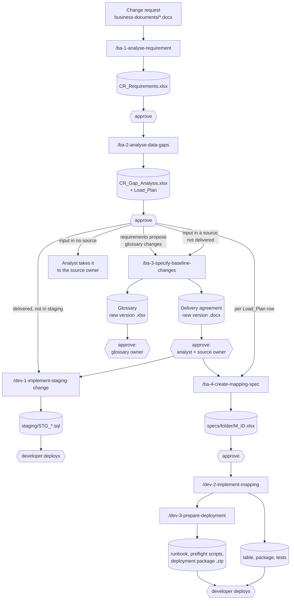

# From a change request to a tested load

This is the end-to-end process for a change to the data warehouse - from a
business or regulatory change request (CR) to new or changed `UBB_CORE2`
tables and their tested loads - with an AI assistant (Claude Code or GitHub
Copilot) doing the legwork at every step. It is written for the people
involved:

- the **analyst**, who turns the change request into requirements, finds
  where the data is (or is not), specifies what the source systems must
  deliver, and writes a precise source-to-target mapping per load;
- the **approvers** (the analyst's reviewer, the business, the source owner),
  who sign each document off;
- the **developer**, who turns the approved documents into database code,
  reviews it, and deploys it by hand.

Six AI skills carry the work. Each one ends with a document a named person
reviews and approves (in Excel or Word) before the next one may start - that
chain of approved documents is the audit trail. A test plan with what to type
and what to expect: [TEST_PLAN.md](TEST_PLAN.md).



| Step | Skill | Who | Starts from | Writes | Approved by |
|---|---|---|---|---|---|
| 1 | `/ba-1-analyse-requirement` | analyst | the CR document | `change-requests/<CR_ID>/<CR_ID>_Requirements.xlsx`: requirements (quoted, each marked explicit, interpretation or assumption), KPIs, dimensions, business rules, required inputs, proposed glossary changes | analyst's reviewer, in Excel |
| 2 | `/ba-2-analyse-data-gaps` | analyst | approved requirements | `<CR_ID>_Gap_Analysis.xlsx`: where every input is, what must change, and the **Load_Plan** | analyst's reviewer, in Excel |
| 3 | `/ba-3-specify-baseline-changes` | analyst | approved gap analysis | a new version of each delivery agreement that must deliver more, `UBB_Delivery_Agreement_<SYS>_v<V>.docx`; and, when the requirements propose glossary changes, a new glossary version `UBB_Credit_Risk_Business_Glossary_v<V>.xlsx` | agreements: analyst and source owner, in Word; glossary: glossary owner, in Excel |
| 4 | `/ba-4-create-mapping-spec` | analyst | one approved Load_Plan row | `specs/<folder>/<MAPPING_ID>.xlsx` | analyst's reviewer, in Excel |
| 5 | `/dev-1-implement-staging-change` | developer | approved agreements | `change-requests/<CR_ID>/staging/STG_*.sql` | developer reviews and deploys |
| 6 | `/dev-2-implement-mapping` | developer | an approved mapping | table, package and tests next to the workbook | developer reviews and deploys |
| 7 | `/dev-3-prepare-deployment` | developer | an approved mapping with generated code | `specs/<folder>/DEPLOY_<MAPPING_ID>_*` (runbook, two preflight scripts) and `deployment-packages/<MAPPING_ID>_<fingerprint>.zip` | developer reviews, then deploys by hand |

A small request that needs no change request (a new report table from data
already in staging) starts directly at step 4 with the request text, as
before.

**Suggestions in steps 1 and 2.** Where the documents leave something
undecided, the assistant does not leave a bare `TODO:`. It fills the cell with
its best understanding, prefixed `SUGGESTION:`, and keeps the open question
(or the Gaps row) `open`. The reviewer accepts it (deletes the prefix, sets
the question or row to `decided`) or changes it. `cr.py validate` fails an
approved document that still contains `SUGGESTION:`.

### Where is the data? The gap levels of step 2

For every input the KPIs need, the gap analysis records one level, with a
reference to the document that shows it:

| Level | Means | What happens |
|---|---|---|
| `in_core` | a CORE table has it, and a load fills it | the mapping reads it (step 4) |
| `in_staging` | staging has it, CORE does not | a mapping loads it (step 4) |
| `in_interface` | the delivery agreement delivers it, staging does not | the developer extends staging (step 5) |
| `in_source` | the source system has it, the interface does not | a new delivery agreement version (step 3), then step 5 |
| `not_in_source` | no source system has it | the analyst takes it to the source owner; the gap analysis records it, no skill follows it up |
| `conflict` | the documents disagree | the owner of the wrong document corrects it first |

"Not in the delivery agreement" is never taken to mean "not in the source
system": only the source systems catalog (or the source owner) says that.

### One change request, several tables

The code generator builds one target table per mapping. A change request
whose KPIs need several steps or grains (for example recognised collateral
per loan and collateral item, then summed per loan) becomes several
mappings. The gap analysis plans them on its **Load_Plan** sheet: one row per
mapping, with its target table, grain, the mappings it depends on, and the
inputs and requirements it serves. Each row is then one run of step 4 and one
of step 6, in plan order. `python tools/change_request/cr.py status <CR_ID>`
shows how far each row has come.

### Versions and approvals

- **Documents of the change request** (requirements, gap analysis, mapping
  workbooks) are one file each, updated in place. Every content change adds a
  revision to the Change_Log sheet; git keeps every earlier state. A content
  change drops the approval: the document must be approved again.
- **Baseline documents** (`business-documents/`: delivery agreements, glossary,
  S2T baseline, source catalog) are never changed. A delivery agreement
  change is a **new file with a higher version** (v1.1; v1.0 for a source
  with no agreement yet) in the change request's folder, and it is the whole
  contract with the additions marked. A glossary change works the same way:
  a new, higher version (v0.4) in the change request's folder, the whole
  glossary with the added and changed rows marked.
- **Glossary changes are decided in step 1 and written in step 3.** The
  Glossary_Changes sheet of the requirements is where the meaning is decided.
  The new glossary version is written only after the gap analysis is
  approved: a step-2 finding that changes a meaning goes back to the
  requirements first, and the glossary version is built from the
  requirements (`Based_On`), so it fails validation whenever they change.
  It blocks no load.
- A document records which version of the approved document before it it was
  built from. When the requirements change after the gap analysis was
  approved, the gap analysis fails validation until it is rewritten and
  approved again, so the chain never silently goes stale.
- The tools refuse to record an approval: only a person sets `approved`, with
  their name and the date, in Excel (Document sheet) or Word (section 6).

### Traceability

```
python tools/change_request/cr.py trace <CR_ID> --xlsx
```

writes `change-requests/<CR_ID>/<CR_ID>_Traceability.xlsx`: requirement ->
KPI or dimension -> input -> gap level and action -> delivery agreement
change -> mapping and its status -> the acceptance criteria that name the
requirement or input.

## Where everything lives

| What | Where | Who writes it |
|---|---|---|
| Baseline documents | `business-documents/` | The analysts' team; never changed by a skill |
| Requirements, gap analysis, new agreement versions, traceability | `change-requests/<CR_ID>/` | Analyst, with steps 1-3 |
| Staging DDL | `change-requests/<CR_ID>/staging/` | Generated by step 5 |
| The mapping (the contract for one load) | `specs/<folder>/<MAPPING_ID>.xlsx` | Analyst, with `/ba-4-create-mapping-spec` |
| Table DDL, change scripts, load package, tests | `specs/<folder>/`, next to the workbook | Generated by `/dev-2-implement-mapping` from the approved mapping |
| Deployment runbook, preflight scripts | `specs/<folder>/DEPLOY_<MAPPING_ID>_*`, next to the workbook | Written by `/dev-3-prepare-deployment` |
| Deployment package (zip) | `deployment-packages/` (git-ignored) | Built by `/dev-3-prepare-deployment` |

## Before you start (once per machine)

1. `pip install -r requirements.txt`
2. Optional but recommended, so mapping workbooks show up as readable text
   in `git diff`:

   ```
   git config diff.xlsx.textconv "python tools/mapping_spec/mapping_workbook.py textconv"
   ```

3. VS Code with Copilot: when VS Code asks, choose **Trust the authors**
   for this folder. `.vscode/settings.json` then approves the repository's
   own tools (`cr.py`, `validate_spec.py`, `mapping_workbook.py`, the
   catalogs, `generate.py`, `pytest`) and edits in `specs/` and `.work/`,
   so the skills run without a prompt for each step. Everything else still
   asks you. In **Autopilot** a command no rule covers is denied, because
   Copilot cannot ask you, so use **Agent** mode with manual approvals if
   a skill stops with a permission denial.

Steps 1-3 and 5 are described in their skills (`.claude/skills/*/SKILL.md`)
and in the walkthrough. The two steps that produce the code-ready contract
and the code are described in full below.

---

## Step 4 - Analyst: describe one load (`/ba-4-create-mapping-spec`)

**You give it:** a change request and one row of its approved Load_Plan
(`CR-ECB-001 M_COLLATERAL_RECOGNITION`), or a small request in any form:
"I need a daily table of every account with its owner's name and city" in
chat, pasted text from a ticket or page, a workbook you already started in
Excel, or the ID of an existing mapping you want to change.

**It gives back:** one workbook, `specs/<folder>/<MAPPING_ID>.xlsx`, with
status `in_review`, and a short summary of every decision and every open
question.

### What the assistant does, in order

1. **Reads the request.** There is no ticket integration: if the request
   lives in a ticket or page, paste its text into the chat.
2. **Researches before asking you anything**, from these sources, and
   writes down what it found on the workbook's **Sources** sheet. No
   database is ever used: the scripts in `sql/` are the source of truth.

   | Source | What it is used for |
   |---|---|
   | Existing mappings (`specs/*/`) | Which mappings already read or write these tables, and how a value is already derived |
   | The scripts in `sql/` | Column names, types, nullability, keys, check constraints (allowed values) and comments from the table scripts |
   | The package scripts in `sql/`, via `package_usage.py` | Which existing procedures write or read the tables that matter (only those), so the assistant reads just those procedures: an existing load of the target, loads that must run first, how joins are really written |
   | The source systems catalog (`business-documents/`), via `source_catalog.py` | Gap analysis: a field the request needs but `sql/` lacks - can a source deliver it (an interface change or a new interface), and do the catalog and `sql/` disagree anywhere. Every gap becomes an open decision, so the mapping cannot be approved until the field exists |

   A fact neither can answer (for example what values a column really holds)
   is a question for the interview next. A table with no `CREATE TABLE`
   script in `sql/` has unknown columns until someone exports it.

3. **Interviews you, one question at a time**, only about what the sources
   could not answer. The decisions it never guesses: the grain (one row per
   what?), the business key, the load strategy and what a re-run does,
   which source rows are in scope, how tables join and what happens to a row
   whose lookup is missing, what is out of scope, and how anyone can tell
   the load worked (the acceptance criteria). Every question and answer
   lands on the **Decisions** sheet.
4. **Writes the workbook.** It builds the mapping as JSON and runs
   `python tools/mapping_spec/mapping_workbook.py write <file>.json`, which
   renders the workbook and validates it. The assistant
   never edits cells directly.
5. **Checks it against the table scripts**:
   `python tools/codegen/verify_mapping.py <MAPPING_ID>`. It reads only the
   scripts in `sql/` and reports:
   - whether every source table and column exists
   - whether a direct copy fits its target type, and whether a nullable
     source column is copied into a NOT NULL target column
   - how the target differs from its table script (new, retyped, missing)
   - whether another package in `sql/` already writes the target table
   - whether each join matches a primary or unique key; if not, the join
     may multiply rows and the grain may be broken (in an aggregating
     mapping that is expected, but two such joins count values twice)
   - whether the business key is unique by construction
   - whether the Reload_Predicate names only target columns

   It cannot look at data (row counts, real key uniqueness, rows an inner
   join leaves out). Those are covered by the acceptance criteria, which
   become tests that the developer runs after deploying.

   Anything that fails is fixed with you before hand-over.
6. **Hands over and stops.** Status becomes `in_review`, and it tells you
   exactly what to check.

### The workbook, sheet by sheet

| Sheet | What it holds |
|---|---|
| Mapping | One value per field: target table, grain, business key, procedure name and parameters, driving table, filter, `Group_By` (only when several source rows are summed into one target row, e.g. collateral per loan), load strategy, what is out of scope, owner, approval |
| Columns | One row per target column, in table order: type, nullable, where the value comes from, the rule as SQL, business name and description |
| Item_Columns | Optional, aggregating loads only: values computed per source row before they are summed, e.g. a running total so a cap follows a priority (the first collateral fills first) |
| Joins | One row per joined table: `inner` (a row without a match is left out) or `left` (kept, with empty values), and the join condition |
| Acceptance_Criteria | One row per test. Three kinds are generated automatically (`unique_key`, `rerun_idempotent`, `all_source_rows_loaded`), two carry your own SQL (`zero_rows`: a query that finds rows breaking the rule; `expected_value`: a query whose single answer must equal Expected), and `guard` is a query that finds source rows which must stop the whole run: the load checks it before writing anything and fails, so no partial snapshot is ever written |
| Sources | Where each finding came from |
| Decisions | Every question raised and its answer. An open decision blocks approval |
| How_To | Instructions for filling it in by hand |

The workbook is strict on purpose: the developer's code is generated from
it without asking anyone anything, so a rule is always SQL
(`TRIM(UPPER(STG_LOAN.LOAN_REF))`), never a sentence ("trim and
uppercase the last name"). Explanations go in the Notes column.

### Approving

Approval is a person's act, never the assistant's. When you are satisfied,
open the workbook in Excel and, on the Mapping sheet, set:

- **Status** = `approved`
- **Approved_By** = your own name
- **Approved_On** = today's date, `YYYY-MM-DD`

Check it is complete with `python tools/mapping_spec/validate_spec.py validate`.
An approved workbook with any `TODO` text, an open decision, a column
without a type or description, or fewer than two acceptance criteria fails
that check.

If anyone changes the content afterwards through the tooling, the approval
is dropped automatically and the mapping goes back to review.

---

## Step 6 - Developer: generate the code (`/dev-2-implement-mapping`)

**You give it:** the approved mapping's ID.

**It gives back:** reviewed, generated SQL files and the instructions to
test them. It never deploys anything.

### What the assistant does, in order

1. **Refuses unless the mapping is approved and valid.** A hook
   (`.claude/hooks/sql_gate.py` for Claude Code, an identical copy in `.github/hooks/` for Copilot) also
   blocks any edit to a `.sql` file in a mapping folder whose mapping is not approved.
2. **Verifies the mapping again, independently of the analyst:**
   - `verify_mapping.py` against the scripts in `sql/` (which may have been
     exported again since the analyst's check)
   - the existing mappings: does another mapping already write this
     table or these columns?

   If anything is wrong, it stops and sends the mapping back to the
   analyst. A developer never quietly "fixes" an approved mapping.
3. **Generates the code** with `python tools/codegen/generate.py <MAPPING_ID>`.
   The SQL wording comes from editable templates in
   `tools/codegen/templates/` (see the README there). The same workbook
   always produces the same code. Every file is written into the mapping's
   own folder, next to the workbook, named after the object it creates.

   | File | What it is |
   |---|---|
   | `<TABLE>.sql` | Full `CREATE TABLE` with primary key and column comments |
   | `<TABLE>_LOAD_LOG.sql` | Only for `scd2`: the table of loaded dates, which a run for an earlier date replays |
   | `<MAPPING_ID>.sql` | Only when the table already exists: the safe `ALTER TABLE` statements (add columns, widen types). Anything that could lose data is listed for a person to decide, never executed |
   | `<PACKAGE>.sql` | The load package. The load strategy decides its shape: `delete_insert`, `full`, `merge`, `append` or `scd2` |
   | `UT_<TABLE>.sql` | utPLSQL tests: one per acceptance criterion, plus a guard that the test data really reaches the load |
   | `UT_<TABLE>_DATA.sql` | Test data. Generated once as a starting point, then owned by the developer; never overwritten |

4. **Finishes the test data.** It replaces the placeholders with realistic
   values (allowed values come from the table scripts in `sql/`: check
   constraints, column comments, lengths), and adds one row for each case the tests must catch: a row outside the filter, a row whose
   join has no match, and so on.
5. **Reviews the generated code** against the workbook, line by line, with
   `references/review-checklist.md`.
6. **Confirms everything is current** with
   `python tools/codegen/generate.py <MAPPING_ID> --check`: every file
   matches the workbook's fingerprint, and no TODO is left.
7. **Hands over** the reviewed files and stops. The next skill,
   `/dev-3-prepare-deployment` (step 7), prepares their deployment.

---

## Step 7 - Developer: prepare the deployment (`/dev-3-prepare-deployment`)

**You give it:** the ID of an approved mapping whose code is generated and
reviewed (step 6).

**It gives back:** a deployment runbook, two read-only preflight scripts and a
deployment package (zip) for deploying from another machine. It never deploys
anything and never runs a script.

### What the assistant does, in order

1. **Refuses unless the mapping is approved and `generate.py --check` passes.**
   It reads the change request's Load_Plan: the mappings with a lower
   `Dependency_Order`, and those in `Depends_On`, must be deployed first.
2. **Prepares the deployment runbook and two preflight scripts**, next to
   the code (`DEPLOY_<MAPPING_ID>_RUNBOOK.md`,
   `DEPLOY_<MAPPING_ID>_PREFLIGHT_1_BEFORE_DDL.sql`,
   `DEPLOY_<MAPPING_ID>_PREFLIGHT_2_BEFORE_RUN.sql`). The runbook lists the
   files in order with the schema, parameters and expected result of each, and
   always has a step that verifies the earlier mappings of the change request
   are deployed. The preflight scripts are read-only: before the DDL they
   check, in the target database, the earlier mappings' objects, the source
   tables and columns, the target state, grants and running loads; before the
   first run, for the business date, the deployed target and package, a single
   writer, and every guard of the mapping. The assistant writes them and
   never runs them. Anything outside the repository (a wrapper, a loader, a
   scheduler setting) is listed as an open item, not invented.
3. **Builds the deployment package**, a zip for deploying from another machine,
   Windows or Linux (`python tools/codegen/package_deployment.py <MAPPING_ID>`,
   written to `deployment-packages/`, which git ignores): one folder named
   after the mapping holding the README and the runbook, one level of
   subfolders for the staging script, grant files, preflight scripts, DDL,
   code and tests, and checksums with `verify.sh` / `verify.ps1`. It refuses stale or
   missing parts.
4. **Hands over** the package, the parameters each script needs and the open
   items, and stops.

### Deploying (by hand, outside the skill)

In this order, in SQL Developer or SQL*Plus (the runbook,
`DEPLOY_<MAPPING_ID>_RUNBOOK.md`, gives the same order for the one mapping, with
parameters; the steps below are the generic outline):

0. The grants the generator printed (read access to the staging tables for
   the load, insert access for the test data).
1. `<MAPPING_ID>.sql` if the table already exists, otherwise
   `<TABLE>.sql`. Run the first preflight script before it.
2. `<PACKAGE>.sql`
3. `UT_<TABLE>_DATA.sql`, then `UT_<TABLE>.sql`
4. Run the tests: `EXEC ut.run('<SCHEMA>.UT_<TABLE>');`
5. Run the second preflight script with the business date of the first run.
6. Run the load for real: call the load procedure with the parameters from
   the workbook, then commit.
7. Export the scripts in `sql/` again, so the repository matches the database.

Every test rolls back what it did, so running the tests never leaves data
behind. That works because generated load procedures never `COMMIT`: the
caller (a scheduler job or the developer's session) commits after the call.

---

## Changing an existing table

The same two steps (4 and 6). Two differences:

- The analyst skill starts from the existing workbook
  (`mapping_workbook.py show <ID> --json`). Any content change drops the
  previous approval, so the mapping needs to be approved again.
- The generator compares the mapping with the table's script in `sql/` and
  writes a change script, `<MAPPING_ID>.sql`, instead of a new `CREATE TABLE`.

**A table that has no mapping yet** (for example `LOAN_HIST`, loaded by the
hand-written `PKG_ETL_LOAN`) first gets its current behaviour written down
as a baseline mapping:

1. The analyst skill reads the package script in `sql/`
   (`sql/UBB_CORE2.schema/PKG_ETL_LOAN_1.sql`) and the table script.
2. It records "baseline reconstructed from the package script" on the
   Decisions sheet.
3. Only then does it apply the requested change.

The regenerated package replaces the hand-written one and follows the
template conventions (for example: no internal `COMMIT`).

## What is enforced, and what is convention

| Rule | Claude Code | GitHub Copilot |
|---|---|---|
| Only a named person approves a mapping | The workbook writer refuses to record an approval | Same (same script) |
| A changed mapping loses its approval | The workbook writer drops it | Same |
| An approved mapping is complete (no TODO, no open decision, every column typed and described, at least 2 tests) | `validate_spec.py validate` | Same |
| Code is only generated from an approved, valid mapping | `generate.py` refuses otherwise | Same |
| Generated SQL is not hand-edited for an unapproved mapping | Hook `.claude/hooks/sql_gate.py` blocks the edit | Identical copy of the hook, `.github/hooks/sql_gate.py` (via `.github/hooks/sql_gate.json`; hooks are a VS Code preview feature and can be turned off) |
| Only a named person approves a change-request document, a delivery agreement version or a glossary version | `cr.py write`, `cr.py write-agreement` and `cr.py write-glossary` refuse to record an approval, and drop one when the content changes | Same (same script) |
| A step starts only from approved, current documents | `cr.py gate`; the writers refuse without an approved predecessor; `Based_On` makes a document invalid when its predecessor changes | Same |
| Baseline documents in `business-documents/` are never changed | `cr.py write-agreement` and `cr.py write-glossary` write only a new, higher version into the change request's folder | Same |
| Staging DDL only from approved agreements, never hand-edited | `generate_staging.py` refuses otherwise; the hook blocks every edit to `change-requests/<CR_ID>/staging/*.sql` | Same (hook where enabled) |
| Deployment | Always by hand, by a developer | Same |

## Command reference

| Command | Used by | Purpose |
|---|---|---|
| `python tools/mapping_spec/mapping_workbook.py schema / write / show / new` | Analyst skill | Create and read mapping workbooks |
| `python tools/mapping_spec/validate_spec.py validate / status` | Everyone | Check every workbook |
| `python tools/mapping_spec/package_usage.py <SCHEMA.TABLE> ...` | Analyst skill | Which package procedures write or read the given tables |
| `python tools/codegen/verify_mapping.py <ID>` | Analyst and developer skills | Check a mapping against the scripts in `sql/` (no database) |
| `python tools/codegen/generate.py <ID> [--check]` | Developer skill | Generate the code, or check it is current |
| `python tools/change_request/cr.py read <file>` | Analyst skills | Any .docx or .xlsx as text (change request, glossary, S2T baseline, catalog, agreements) |
| `python tools/change_request/cr.py schema / write / show` | ba-1, ba-2 | Create and read the requirements and gap analysis workbooks |
| `python tools/change_request/cr.py agreement-json / write-agreement` | ba-3 | Read a delivery agreement as JSON; write its new version |
| `python tools/change_request/cr.py glossary-json / write-glossary` | ba-3 | Read the glossary as JSON; write its new version from the requirements' Glossary_Changes |
| `python tools/change_request/cr.py validate / status / gate / trace` | Everyone | Check the documents, see where a CR stands, whether a step may start, the traceability matrix |
| `python tools/mapping_spec/source_catalog.py find / gaps` | ba-2, ba-4 | What the source systems have, compared with `sql/` |
| `python tools/codegen/generate_staging.py <CR_ID> [--check]` | dev-1 | Generate the staging DDL from approved agreements, or check it is current |

## How this was verified

The generator and templates were checked against a real Oracle database when
they were first written, not only by unit tests. That check was done on an
earlier version of this repository and has not been repeated since the tools
were changed to read table definitions from `sql/` instead of a database:

- **Setup:** a throwaway local Oracle XE 21c container, with utPLSQL 3.2.3,
  the real staging DDL and several days of generated staging data.
- **Load strategies:** a sample mapping was generated for each of the four
  strategies `full`, `delete_insert`, `merge` and `append`, and all of them
  compiled and passed their generated tests. `scd2` was added later and has
  not been compiled on a database yet.
- **Modifying a table:** adding a column and widening another produced a
  change script that deployed cleanly, and the regenerated tests passed.
- **Mutation testing:** the package was deliberately broken three ways, and
  each break was caught by the test meant to catch it:
  - forgetting the delete before reloading
  - turning the inner join into a left join
  - computing a value wrongly
- **Clean-up:** every test left the target table empty afterwards, because
  utPLSQL rolls back what each test did.

`python -m pytest -q` covers the script reader (`schema_catalog`),
`package_usage`, the checks in `verify_mapping.py`, the table change plan,
the generated-code gate hook, and the guards that keep the skill copies in
step and the tools free of database access - without needing a database.
