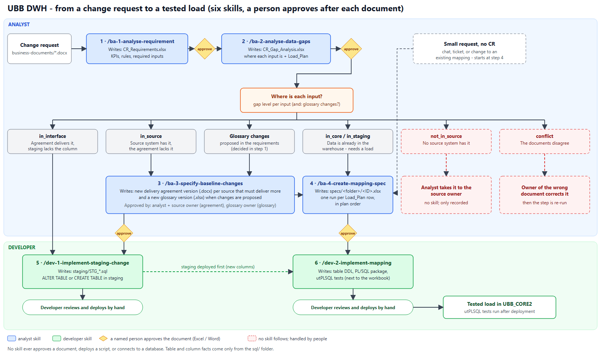

# The seven skills at a glance

A short overview of the seven AI skills that take a change request (CR) to a
tested, deployable load. A "skill" is a written checklist the AI assistant follows; it
runs small Python tools and never connects to a database (table and column
facts come only from the `sql/` folder). The full process is in
[WORKFLOW.md](WORKFLOW.md); two skills have a longer walk-through:
[ba-4](ba-4-create-mapping-spec-explained.md) and
[dev-2](dev-2-implement-mapping-explained.md).

([SVG version](workflow_diagram.svg))

## The idea in four lines

1. Each skill turns the approved document before it into the next document.
2. **A named person approves every document** (in Excel or Word) before the
   next skill may start. The assistant never approves anything.
3. **A developer deploys every script by hand.** The assistant never deploys.
4. `python tools/change_request/cr.py status <CR_ID>` shows where a change
   request stands and what comes next.

## The skills

### 1. `/ba-1-analyse-requirement` - analyst
- **Question it answers:** what does the business actually ask for?
- **Starts from:** the change request document (`business-documents/*.docx`).
- **Produces:** `<CR_ID>_Requirements.xlsx` - requirements quoted from the CR,
  KPIs, dimensions, business rules, every input the KPIs need, proposed
  glossary changes.
- **Asks the analyst** only what the documents cannot answer. Unclear points
  are filled in as `SUGGESTION:` for the reviewer to accept or change.

### 2. `/ba-2-analyse-data-gaps` - analyst
- **Question it answers:** where is each required input today?
- **Starts from:** the approved requirements.
- **Produces:** `<CR_ID>_Gap_Analysis.xlsx` - one gap level per input
  (`in_core`, `in_staging`, `in_interface`, `in_source`, `not_in_source`,
  `conflict`) with a reference, and the **Load_Plan**: one mapping per target
  table, in order.
- **Note:** an input no source system has is only recorded; the analyst takes
  it to the source owner.

### 3. `/ba-3-specify-baseline-changes` - analyst
- **Question it answers:** what must a source deliver, or what must the
  glossary say, that it does not today?
- **Starts from:** the approved gap analysis (and the proposed glossary
  changes in the requirements).
- **Produces:** a new version of each delivery agreement that must deliver
  more (`UBB_Delivery_Agreement_<SYS>_v<V>.docx`, v1.0 for a source with no
  agreement yet) and, when needed, a new glossary version. Additions are
  marked and listed; the approved baselines are never changed.
- **Approved by:** analyst and source owner (agreement), glossary owner
  (glossary).

### 4. `/ba-4-create-mapping-spec` - analyst
- **Question it answers:** exactly how does data get from source to one target
  table?
- **Starts from:** one approved Load_Plan row - or a small request with no CR
  (chat text, ticket, half-filled workbook, change to an existing mapping).
- **Produces:** `specs/<folder>/<MAPPING_ID>.xlsx` - column rules written as
  SQL, joins, keys, load behaviour, acceptance criteria - verified against the
  table scripts in `sql/`.
- **Run once per Load_Plan row**, in plan order.

### 5. `/dev-1-implement-staging-change` - developer
- **Question it answers:** what must staging receive?
- **Starts from:** the approved delivery agreements (and `in_interface` inputs
  of the gap analysis).
- **Produces:** `change-requests/<CR_ID>/staging/STG_*.sql` - `ALTER TABLE`
  for new attributes, `CREATE TABLE` for a new delivery entity. Only columns
  the CR asks for; type conflicts are listed as manual decisions.
- **Developer then:** deploys the scripts before any load that reads the new
  columns, and updates the loader that reads the delivered files (outside this
  repository).

### 6. `/dev-2-implement-mapping` - developer
- **Question it answers:** what is the database code for this mapping?
- **Starts from:** an approved mapping workbook.
- **Produces:** next to the workbook - table DDL, the PL/SQL load package and
  utPLSQL tests, reviewed against the workbook. Generated files are never
  hand-edited (only the test data package is).
- **Developer then:** deploys by hand and runs the tests.

### 7. `/dev-3-prepare-deployment` - developer
- **Question it answers:** in what order, and with which checks, do I deploy
  this mapping, possibly from another machine?
- **Starts from:** an approved mapping whose code `/dev-2-implement-mapping`
  has generated and reviewed.
- **Produces:** next to the workbook - a deployment runbook (it always has a
  step that verifies the earlier mappings of the change request are deployed)
  and two read-only preflight scripts (table columns, grants, running loads,
  the mapping's guards for the first business date); and a deployment package,
  a zip for Windows or Linux with checksums and verify scripts.
- **Developer then:** reviews, verifies the package on the other machine, and
  runs the preflight scripts and the SQL by hand, as the runbook says.

## Summary table

| # | Skill | Who | Input | Output | Approved / deployed by |
|---|---|---|---|---|---|
| 1 | `/ba-1-analyse-requirement` | analyst | CR document | Requirements.xlsx | reviewer |
| 2 | `/ba-2-analyse-data-gaps` | analyst | approved requirements | Gap_Analysis.xlsx + Load_Plan | reviewer |
| 3 | `/ba-3-specify-baseline-changes` | analyst | approved gap analysis | agreement and glossary versions | analyst + source owner; glossary owner |
| 4 | `/ba-4-create-mapping-spec` | analyst | one Load_Plan row or request | mapping workbook | reviewer |
| 5 | `/dev-1-implement-staging-change` | developer | approved agreements | `STG_*.sql` | developer deploys |
| 6 | `/dev-2-implement-mapping` | developer | approved mapping | table, package, tests | developer deploys |
| 7 | `/dev-3-prepare-deployment` | developer | approved mapping with generated code | runbook, preflight scripts, deployment package (zip) | developer deploys |

## The options in the diagram

After the gap analysis, each input follows the path its gap level says:

| Gap level | What happens |
|---|---|
| `in_core` / `in_staging` | straight to a mapping (skill 4, then 6) |
| `in_interface` | staging is extended (skill 5), then the mapping |
| `in_source` | new delivery agreement version (skill 3), then skill 5 and the mapping |
| glossary changes proposed | new glossary version (skill 3); blocks no load |
| `not_in_source` | the analyst takes it to the source owner; no skill follows |
| `conflict` | the owner of the wrong document corrects it, then the step is re-run |
| small request without a CR | starts directly at skill 4 |
